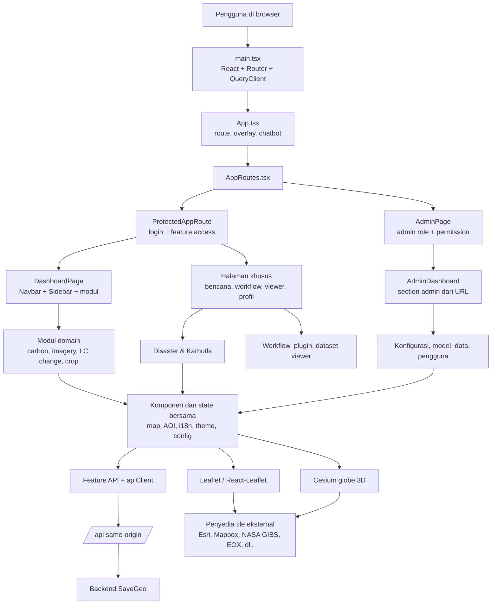
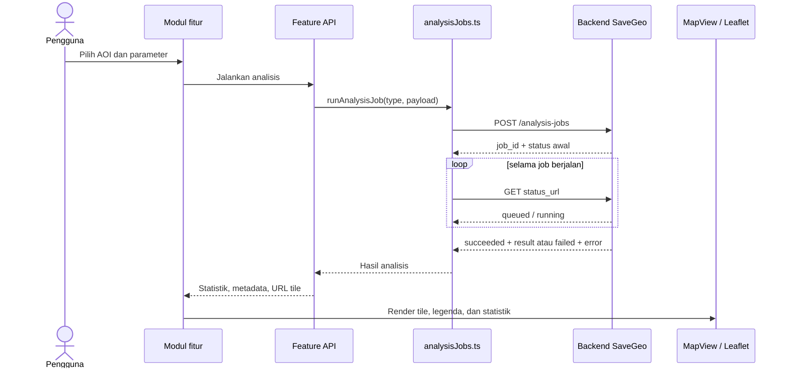
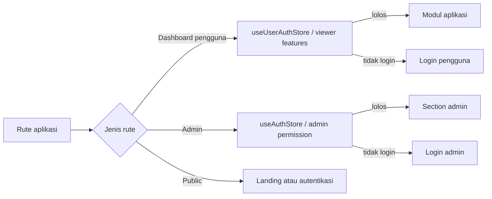
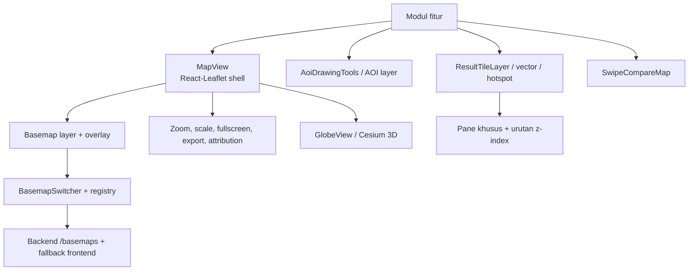

# Arsitektur Frontend SaveGeo

Dokumen ini adalah peta arsitektur frontend SaveGeo untuk product owner, pengembang baru, dan tim operasional. Tujuannya membantu pembaca memahami susunan aplikasi dan alur data tanpa harus menelusuri semua file sumber.

> Cakupan dokumen: aplikasi di folder `frontend/`. Backend, database, Earth Engine, dan penyedia citra digambarkan sebagai layanan di luar frontend.

## Ringkasan dalam satu menit

- **React 18 + TypeScript + Vite** membentuk aplikasi browser.
- **React Router** memilih halaman dari URL. Halaman dashboard, admin, bencana, workflow, dan halaman pendukung memiliki rute masing-masing.
- **Fitur dikelompokkan berdasarkan domain** di `src/features/`; komponen peta, layout, autentikasi, konfigurasi, dan API bersama berada di folder bersama.
- **Zustand** menyimpan state lintas komponen dan lintas modul. State layar yang tidak dipakai bersama biasanya tetap lokal di komponen.
- **API backend** dipanggil melalui `src/services/apiClient.ts`. Analisis panjang memakai job asinkron dan polling; browser menerima status serta hasil/tile.
- **Leaflet** menampilkan peta 2D. **Cesium** menampilkan globe 3D. Tile dari penyedia peta dapat diminta langsung oleh browser.
- **Akun admin dan pengguna aplikasi** memakai store dan endpoint sesi yang terpisah. Keduanya menggunakan cookie HttpOnly dari backend.

## Diagram arsitektur



### Siklus analisis panjang



## Titik masuk aplikasi dan navigasi

| Berkas | Tanggung jawab |
| --- | --- |
| `src/main.tsx` | Membuat React root, memasang `QueryClientProvider` dan `BrowserRouter`, serta style global. Query cache dibersihkan saat sesi berakhir. |
| `src/App.tsx` | Memasang route tree, overlay loading global, dan chatbot untuk pengguna yang sudah login. |
| `src/routes/AppRoutes.tsx` | Sumber utama definisi URL, guard, redirect khusus, dan halaman yang dirender. |
| `src/pages/DashboardPage.tsx` | Shell dashboard biasa: Navbar, Sidebar, footer, dan modul utama. Modul baru dirender saat pertama dibuka lalu dipertahankan tersembunyi agar state dan peta tetap hidup saat berpindah modul. |
| `src/components/layout/DashboardShell.tsx` | Shell yang sama untuk halaman khusus pemetaan bencana. |
| `src/pages/AdminPage.tsx` | Memeriksa sesi admin, role, dan permission sebelum merender dashboard admin. |
| `src/features/admin/AdminDashboard.tsx` | Navigasi section admin dan panel pengelolaan. URL menentukan section yang aktif. |

### Kelompok rute utama

| Area | Rute penting | Keterangan |
| --- | --- | --- |
| Publik dan akun | `/`, `/login`, `/register`, `/reset-password` | Landing, login/registrasi pengguna aplikasi, dan pemulihan kata sandi. |
| Dashboard | `/dashboard`, `/carbon-estimation`, `/land-cover-change`, `/lc-change`, `/satellite-imagery`, `/imagery`, `/crop-monitoring`, `/guide`, `/about` | `/dashboard` mengarahkan sesi ke tujuan berdasarkan role dan hak fitur. Beberapa URL lama tetap menjadi alias. |
| Bencana | `/pemetaan-bencana`, `/pemetaan-bencana/:eventId`, `/pemetaan-bencana/karhutla`, `/pemetaan-bencana/karhutla/:eventSlug` | Daftar kejadian, detail kejadian, dan pemantauan kebakaran. Rute ini memakai `DashboardShell`. |
| Rute bencana kompatibilitas | `/disaster`, `/disaster/event/:eventId` | Modul dashboard bencana lama dan alias detail yang masih didukung. Sidebar utama mengarahkan ke `/pemetaan-bencana`. |
| Admin | `/admin`, `/admin/overview`, `/admin/gee-credentials`, `/admin/arcgis`, `/admin/ml-models`, `/admin/carbon-calibration`, `/admin/system-config`, `/admin/users`, `/admin/viewer-features`, `/admin/satellite-providers`, `/admin/company-boundaries`, `/admin/disasters/new`, `/admin/disasters/:eventId/:tab?`, `/admin/disasters`, `/admin/geospatial-data`, `/admin/research-information`, `/admin/profile` | Setiap section admin memiliki URL sendiri dan dirender di dalam gerbang autentikasi serta pemeriksaan role/permission. Detail kejadian admin memakai parameter tab opsional. |
| Analisis dan integrasi | `/workflow/*`, `/embed/workflow/:workflowId`, `/embed/map/:mapId`, `/settings/plugins`, `/dataset-viewer` | Workflow, embed, plugin, dan viewer dataset geospasial. |
| Profil dan akses | `/profile`, `/admin/profile`, `/no-features` | Profil pengguna/admin serta halaman saat akun tidak memiliki fitur aktif. |

Rute lengkap dan redirect ada di `src/routes/AppRoutes.tsx`. Misalnya, `/carbon-estimation?mode=landcover_change` diarahkan ke `/land-cover-change` sambil mempertahankan parameter query.

## Peta modul dan tanggung jawabnya

| Domain | Entry point utama | Tanggung jawab |
| --- | --- | --- |
| Estimasi karbon | `src/features/carbon/CarbonModule.tsx` | AOI, estimasi AGB/BGB/SOC, mode simpel/lanjutan, dataset/model, hasil dan tile karbon. Modul ini juga menggabungkan panel tutupan lahan dan indeks vegetasi. |
| Tutupan lahan | `src/features/landcover/` | API, tipe, dan katalog yang dipakai oleh modul karbon untuk analisis Dynamic World/land cover. Bukan halaman dashboard terpisah. |
| Vegetasi | `src/features/vegetation/` | Indeks, parameter, time series, tabel, dan API yang dipakai bersama modul karbon. |
| Perubahan tutupan lahan | `src/features/lc-change/LcChangeModule.tsx` | Perbandingan tahun, transisi, hotspot, fusi optik/SAR, peta before-after dan statistik. |
| Eksplorasi citra satelit | `src/features/imagery/ImageryModule.tsx` | Katalog scene/provider, tanggal akuisisi, perbandingan scene, preview dan layer citra. |
| Pemetaan bencana | `src/features/disaster/` | Daftar kejadian, detail, AOI, citra pre/post, hasil analisis, hotspot, sumber data, dan statistik. |
| Kebakaran hutan/lahan | `src/features/karhutla/` | Peta titik api dan data sumber kebakaran, filter waktu/wilayah, CAMS/GFAS, serta halaman event seperti Kalimantan atau Papua. |
| Monitoring tanaman | `src/features/crop-monitoring/CropMonitoringModule.tsx` | Field, periode, cuaca, kelembapan, fase pertumbuhan, risiko banjir, produktivitas, dan indikator tanaman. |
| Administrasi | `src/features/admin/` | Credential, konfigurasi, model, kalibrasi karbon, pengguna, provider, batas perusahaan, kejadian bencana, serta katalog data. |
| Chatbot | `src/features/chatbot/ChatWidget.tsx` | Percakapan, konteks halaman/peta, perintah navigasi, pemilihan AOI, dan eksekusi aksi UI. |
| Dataset geospasial | `src/features/geospatial/` dan `src/geospatial/` | Dataset cloud-native, COG/GeoTIFF, PMTiles, validasi query spasial, cache, dan worker untuk sebagian query lokal. |
| Workflow | `src/workflow/`, `src/pages/WorkflowBuilderPage.tsx` | Definisi, validasi, penyimpanan, plugin, dan eksekusi workflow analisis. |
| Laporan | `src/features/reports/` | Konteks dan fungsi ekspor laporan dari hasil analisis. |
| Konten informasi | `src/components/modules/` | Panduan penggunaan dan halaman Tentang. |

Setiap domain umumnya menaruh komponen, API, tipe, dan helper di dalam `src/features/<domain>/`. Tidak semua domain memiliki `Module.tsx`; sebagian merupakan subfitur atau halaman khusus yang dipasang oleh router.

## Susunan folder

```text
src/
├── routes/          Pemetaan URL, section admin, dan entry dashboard
├── pages/           Halaman tingkat aplikasi: login, dashboard, admin, workflow, viewer
├── components/
│   ├── layout/      Navbar, sidebar, shell, loading overlay
│   ├── map/         MapView, AOI, basemap, swipe, kontrol peta, globe bridge
│   ├── auth/        Route guard dan UI autentikasi
│   └── ui/          Select, InfoTip, rich text, komponen form bersama
├── features/        Kode domain SaveGeo, feature-centric
├── services/        apiClient, autentikasi, job, region, release, layer
├── hooks/           Zustand stores dan hook lintas fitur
├── auth/            Kebijakan role, permission, dan feature viewer
├── config/          Env publik, basemap, zoom, pane, versi
├── geospatial/      COG, PMTiles, DuckDB-WASM, worker, query spasial
├── workflow/        Engine dan skema workflow
├── i18n/            Bahasa Indonesia/Inggris dan kamus terjemahan
├── styles/          CSS global dan styling per fitur
├── types/           Tipe data bersama
└── lib/             URL state dan utilitas lintas domain
```

## State, URL, dan cache

State dibagi menurut cakupan agar satu state tidak menjadi tempat penampungan semua hal:

| Cakupan | Mekanisme | Contoh |
| --- | --- | --- |
| Lokal komponen | React `useState`, `useReducer`, `useMemo` | Tab aktif, parameter sementara, loading/error satu panel. |
| Lintas komponen/modul | Zustand di `src/hooks/` atau store fitur | AOI bersama, user/session, UI dashboard, bahasa, konfigurasi, permission, dan status analysis job. |
| Data server/cache request | TanStack Query pada tempat yang memakainya; service API tetap menjadi batas request bersama | Daftar kejadian, katalog/provider, cache query dan refetch. Tidak semua endpoint harus memakai React Query. |
| Link yang dapat dibagikan | Query string URL | Mode analisis, tahun, tanggal, basemap, scene, tampilan, serta descriptor AOI. Parser/serializer ada di `src/lib/` atau `features/<domain>/lib/`. |
| Preferensi browser | `localStorage` | Bahasa, tema, modul terakhir, dan status sidebar. Data AOI utama tidak dianggap sebagai backend persistence. |

Helpers query penting:

- `src/lib/moduleQueryState.ts`: state peta dan analisis generik, termasuk basemap, view, scene, AOI, dan parameter globe.
- `src/features/carbon/lib/carbonQueryState.ts` dan `aoiRegionQuery.ts`: query mode karbon/vegetasi/tutupan lahan serta wilayah AOI.
- `src/features/lc-change/lib/lcChangeQueryState.ts`: pembungkus query state perubahan tutupan lahan.
- `src/features/karhutla/`: query filter kebakaran disimpan lewat helper khusus dan disinkronkan ke URL.
- `src/components/map/globe3d/query.ts`: kamera dan opsi globe 3D.

State lintas modul yang penting adalah AOI (`useAoiStore`). Modul yang menerima AOI bersama dapat memakai geometri, nama, luas, dan bounds tanpa mengirim state melalui banyak komponen perantara.

## Autentikasi dan otorisasi

SaveGeo memiliki dua principal yang berbeda. Jangan menyatukan keduanya dengan asumsi satu endpoint atau satu hak akses:

| Jenis sesi | Store/service | Endpoint dasar | Pemakaian |
| --- | --- | --- | --- |
| Admin | `useAuthStore` + `authService` | `/admin/auth/*` | Panel admin dan administrasi konfigurasi/model/data. Permission section diperiksa oleh `canAccessAdminSection`. |
| Pengguna aplikasi/viewer | `useUserAuthStore` + `userAuthService` | `/auth/*` | Dashboard pengguna, kejadian bencana, dan fitur yang diberikan kepada viewer. |

Kedua sesi diverifikasi ke backend dan menggunakan cookie HttpOnly. Request mengirim `credentials: "include"`; frontend tidak menyimpan bearer token sesi di Web Storage. `ProtectedAppRoute` mengatur login dan akses fitur viewer. `useViewerFeatures` mengambil daftar fitur akun dari `/app/features`. `AdminPage` memeriksa role/permission admin sebelum membuka section.

Alur akses ringkas:



## API dan pemrosesan analisis

### Jalur request

1. Komponen atau hook memakai API domain, misalnya `features/carbon/api.ts`.
2. API domain membentuk payload dan memanggil `apiClient`, atau `runAnalysisJob` untuk analisis panjang.
3. `apiClient` menambahkan base URL dari `VITE_API_BASE_URL`, mengirim cookie, membentuk JSON/FormData, menerapkan timeout, menerjemahkan response error menjadi `ApiError`, dan menjalankan penanganan sesi 401 sesuai jenis auth.
4. Backend mengembalikan data, status job, atau URL tile. Frontend menyusun tampilan/legenda dan peta.

Di pengembangan, Vite berjalan pada port `5501` dan mem-proxy `/api` serta `/disaster-thumbnails` ke backend lokal `8086`. Produksi memakai URL same-origin seperti `/api` di belakang reverse proxy.

### Request langsung dan analysis job

- Endpoint cepat/list/config dipanggil langsung melalui `apiClient`.
- Analisis yang lama memakai `runAnalysisJob` di `src/services/analysisJobs.ts`: `POST /analysis-jobs`, simpan status di `useAnalysisJobStore`, polling `status_url`, lalu mengembalikan hasil atau error.
- Setiap domain mempertahankan tipe/payload di API dan `types.ts` miliknya. Tipe job yang didukung tercantum di `analysisJobs.ts`.
- Frontend mengonsumsi URL tile/metadata hasil. Inferensi geospasial berat dijalankan backend/provider, sedangkan rendering layer dan interaksi pengguna dikelola frontend.

### Batas layanan dan data

| Sumber | Jalur browser | Peran |
| --- | --- | --- |
| Backend SaveGeo | `/api/*` | Autentikasi, konfigurasi, katalog, AOI/wilayah, analysis jobs, statistik, metadata, dan hasil/tile sesuai endpoint. |
| Thumbnail bencana | `/disaster-thumbnails/*` | Asset thumbnail melalui proxy backend. |
| Provider peta/citra | URL tile provider | Tile basemap/arsip yang dirender langsung di browser, misalnya Esri, Mapbox opsional, NASA GIBS, EOX, USGS, Google opsional, dan sumber lain yang terkonfigurasi. |
| Earth Engine atau sumber analitik | Umumnya diakses backend | Membentuk komposit, menjalankan model, dan membuat tile hasil; frontend menerima kontrak API/URL hasil. |
| File/dataset browser | `src/geospatial/` | Pembacaan atau query lokal untuk alur yang memang mendukung COG/GeoTIFF/PMTiles/DuckDB-WASM. |

`VITE_` berarti nilai dapat terlihat di bundle browser. Hanya konfigurasi publik dan token browser yang dibatasi domain boleh berada di sana; secret backend tetap di server.

## Arsitektur peta



- `src/components/map/MapView.tsx` adalah shell peta 2D bersama. Ia membuat Leaflet map, basemap, kontrol umum, resize behavior, attribution, registrasi peta untuk chatbot, dan bridge ke globe.
- `useBasemaps()` memuat registry basemap dari backend, menggabungkannya dengan fallback frontend, lalu menambahkan provider opsional sesuai konfigurasi publik.
- Result raster menggunakan pane khusus (`src/config/mapPanes.ts`) agar basemap, tile hasil, jalan referensi, AOI, dan marker memiliki urutan visual yang stabil.
- `ResultTileLayer` menangani pemasangan/pembersihan tile hasil, retry tile, resolusi/native zoom, dan clipping AOI bila tersedia.
- `SwipeCompareMap` menyinkronkan dua peta/layer dan pembatas swipe tanpa mencampur sumber pre/post.
- Kontrol tambahan meliputi AOI gambar/impor, opacity, histori imagery, skala/resolusi, ekspor, koordinat, fullscreen, dan user location.
- `Globe3DView.tsx` adalah renderer Cesium. State kamera dan sebagian opsi disimpan di URL; terrain/buildings bergantung pada konfigurasi provider.

## Bahasa, tema, dan tampilan

- Bahasa aplikasi: Indonesia dan Inggris. Store dan fungsi terjemahan berada di `src/hooks/useI18nStore.ts` dan `src/i18n/`.
- Tema light/dark disimpan di `localStorage`, diterapkan melalui `data-theme` pada root dokumen, dan memperbarui default warna Chart.js.
- Bootstrap menyediakan dasar grid/form, sedangkan `src/styles/` mengatur desain aplikasi, admin, landing, workflow, dan interaksi peta.
- Komponen bersama yang sering dipakai: `InfoTip`, `SearchableSelect`, `MultiSearchableSelect`, `AsyncLocationSelect`, pagination, serta map controls.

## Panduan membaca kode menurut kebutuhan

| Ingin memahami... | Mulai dari... |
| --- | --- |
| URL dan hak akses | `src/routes/AppRoutes.tsx`, `src/components/auth/ProtectedAppRoute.tsx`, `src/auth/` |
| Navigasi dashboard | `src/pages/DashboardPage.tsx`, `src/components/layout/Sidebar.tsx`, `src/routes/dashboardModuleRoutes.ts` |
| Panel admin | `src/pages/AdminPage.tsx`, `src/features/admin/AdminDashboard.tsx`, `src/routes/adminSectionRoutes.ts` |
| Request API/error | `src/services/apiClient.ts`, lalu `src/features/<domain>/api.ts` |
| Analisis lama | `src/services/analysisJobs.ts`, `src/services/analysisJobStore.ts`, lalu API domain |
| AOI lintas modul | `src/hooks/useAoiStore.ts`, `src/components/map/AoiDrawingTools.tsx`, `src/features/carbon/components/AoiPanel.tsx` |
| Tile, basemap, dan swipe | `src/components/map/MapView.tsx`, `BasemapSwitcher.tsx`, `ResultTileLayer.tsx`, `SwipeCompareMap.tsx` |
| Query link yang bisa dibagikan | `src/lib/moduleQueryState.ts` dan helper `lib/*QueryState.ts` di fitur terkait |
| Peta/globe 3D | `src/components/map/Globe3DView.tsx`, `globe3d/`, `src/config/satelliteBasemapGroups.ts` |
| Data lokal COG/PMTiles | `src/geospatial/` dan `src/features/geospatial/` |
| Chatbot dan command UI | `src/features/chatbot/ChatWidget.tsx`, `actionExecutor.ts`, `uiCommandBus.ts`, `mapActions.ts` |

## Menambahkan fitur tanpa menyebarkan tanggung jawab

1. Tentukan dulu apakah fitur adalah **modul dashboard**, **halaman mandiri**, atau **subpanel dari domain yang ada**. Tambahkan URL di `src/routes/AppRoutes.tsx` dan metadata/nav yang sesuai.
2. Simpan kode domain di `src/features/<domain>/`: komponen, tipe, API, dan helper domain. Hindari menaruh logika domain di `App.tsx` atau komponen global.
3. Letakkan request HTTP di API domain atau `src/services/` bila benar-benar dipakai lintas domain. Gunakan `apiClient`; jangan membuat konfigurasi auth/timeout sendiri di komponen.
4. Untuk analisis lama, gunakan pola `runAnalysisJob` dan tipe result yang jelas. Jangan menahan interaksi aplikasi dengan fetch panjang tanpa status/cancel flow.
5. Gunakan `useAoiStore` hanya untuk AOI yang memang perlu dibagi lintas modul. Untuk state lokal panel, pakai state React.
6. Untuk peta, komposisikan `MapView` dengan layer/controls khusus. Tetapkan pane bila layer perlu berada di atas/bawah layer lain; jaga attribution provider.
7. Jika pilihan harus bisa dibagikan, buat parser/serializer query state dan validasi nilai dari URL. Jangan menganggap query string sebagai data tepercaya.
8. Tambahkan teks baru ke kamus Indonesia dan Inggris; gunakan key terjemahan, bukan menaruh banyak teks langsung di komponen.
9. Komponen React dan fungsi query/data memiliki pola test Vitest di dekat modulnya (`*.test.ts[x]`). Build utama menjalankan pemeriksaan TypeScript sebelum Vite bundling.

## Konfigurasi dan perintah pengembangan

Konfigurasi publik dibaca di `src/config/env.ts` dan file `.env*` frontend. Contoh nilainya ada di `.env.example`.

```powershell
npm ci
npm run dev
npm run lint
npm test
npm run build
```

`npm run dev` membuka `http://localhost:5501`; proxy Vite mengharapkan backend lokal di `http://127.0.0.1:8086`. Untuk detail deploy, reverse proxy, workflow CI, dan troubleshooting lihat [OPERATIONS.md](../OPERATIONS.md) dan [README.md](../README.md).

## Istilah yang dipakai

| Istilah | Arti di frontend |
| --- | --- |
| AOI | Area of Interest: geometri yang dipakai untuk membatasi analisis dan/atau tampilan peta. |
| Scene | Satu item citra/provider dengan metadata tanggal, sensor, resolusi, dan sumber. |
| Tile | Potongan raster yang diminta per koordinat/zoom untuk menggambar peta. |
| Analysis job | Pekerjaan analisis backend yang memiliki ID dan status, dipantau frontend sampai selesai/gagal. |
| Pane | Lapisan rendering Leaflet dengan urutan z-index tertentu. |
| Feature viewer | Hak akses per modul yang dikirim backend dan diperiksa sebelum fitur ditampilkan. |
